# 🛠️ Packet Tracer - Troubleshooting numa Rede LAN

**Cisco Packet Tracer Lab**  
**Autor:** Jordão Paulo  
**Categoria:** Redes de Computadores • Cisco Packet Tracer • Cisco Networking Academy (NetAcad)  
**Nível:** Intermediário  

---

## 📖 Descrição

Este laboratório apresenta uma atividade prática focada no diagnóstico e na resolução de falhas de conectividade (**Troubleshooting**) em uma infraestrutura de rede corporativa simulada no Cisco Packet Tracer para a empresa **OLX ANGOLA, LDA**.

O ambiente é composto por múltiplos departamentos empresariais (**Dep. Vendas**, **Dep. Finanças** e **Sala de Reunião**) interconectados por roteamento centralizado, além de conectividade WAN via Cluster/Nuvem simulada até um Servidor Externo. O objetivo é aplicar metodologias estruturadas de diagnóstico para identificar e corrigir falhas de endereçamento IP, máscaras de rede, atribuição DHCP, resolução DNS e roteamento.

---

## 📥 Downloads e Recursos

| Recurso | Ação |
| :--- | :--- |
| **Arquivo do Lab (.pkt/.pka)** | [](#) |
| **Vídeo Explicativo** | [](#) |

---

## 🎯 Objetivos do Laboratório

* **Verificar Conectividade Fim a Fim:** Executar testes sistemáticos com `ping` e `traceroute` entre departamentos locais e servidores externos.
* **Analisar Endereçamento IP & DHCP:** Auditar as configurações estáticas e os escopos dinâmicos distribuídos pelos servidores DHCP em cada departamento.
* **Diagnóstico na Camada de Enlace & Roteamento:** Inspecionar portas de switches, interfaces de roteadores (`Gig0/0`, `Gig0/1`, `Gig0/2`) e tabelas de roteamento.
* **Resolução de Serviços:** Validar a comunicação com a rede externa (`Cluster0` / `Server0`).

---

## 🏗️ Topologia da Rede (Mermaid Diagram)

```mermaid
graph TD
    subgraph WAN_Ext ["🌐 Nuvem WAN & Servidores Externos"]
        Cluster0["☁️ Cluster0<br/>209.165.200.100/8"]
        Server0["🖥️ Server0<br/>172.16.30.200/16"]
        Cluster0 ---|Gig0/1 - Fa0| Server0
    end

    subgraph Router_Core ["🌐 Roteador Central"]
        Router["🛡️ OLX ANGOLA, LDA<br/>(Roteador Core)"]
    end

    subgraph Dep_Vendas ["🔵 Dep. Vendas (192.168.1.0/24)"]
        Switch_Vendas["🔀 Switch Vendas"]
        DHCP_Vendas["🖥️ Server-PT (DHCP)"]
        PC_Vendas0["💻 PC0"]
        PC_Vendas1["💻 PC1"]
        PC_Vendas2["💻 PC2"]
        Printer_Vendas["🖨️ Printer0"]

        Switch_Vendas --- DHCP_Vendas
        Switch_Vendas --- PC_Vendas0
        Switch_Vendas --- PC_Vendas1
        Switch_Vendas --- PC_Vendas2
        Switch_Vendas --- Printer_Vendas
    end

    subgraph Dep_Financas ["🟣 Dep. Finanças (192.168.2.0/24)"]
        Switch_Financas["🔀 Switch Finanças"]
        DHCP_Financas["🖥️ Server-PT (DHCP)"]
        PC_Financas0["💻 PC0(1)"]
        PC_Financas1["💻 PC1(1)"]
        PC_Financas2["💻 PC2(1)"]
        Printer_Financas["🖨️ Printer0(1)"]

        Switch_Financas --- DHCP_Financas
        Switch_Financas --- PC_Financas0
        Switch_Financas --- PC_Financas1
        Switch_Financas --- PC_Financas2
        Switch_Financas --- Printer_Financas
    end

    subgraph Sala_Reuniao ["🟢 Sala de Reunião (Wireless)"]
        Switch_Reuniao["🔀 Switch0"]
        AP_Reuniao["📡 AccessPoint-PT"]
        Laptop0["💻 Laptop0"]
        Laptop1["💻 Laptop1"]

        Switch_Reuniao --- AP_Reuniao
        AP_Reuniao -.-|Wireless| Laptop0
        AP_Reuniao -.-|Wireless| Laptop1
    end

    %% Conexões do Roteador Core
    Router ---|Gig0/0| Cluster0
    Router ---|Gig0/1| Switch_Vendas
    Router ---|Gig0/2| Switch_Financas
    Switch_Financas ---|Fa0/1 - Fa0/1| Switch_Reuniao

    style Router fill:#003366,stroke:#0066cc,stroke-width:2px,color:#fff
    style Cluster0 fill:#004d66,stroke:#008080,stroke-width:2px,color:#fff
    style Dep_Vendas fill:#0d233a,stroke:#2b5c8f,stroke-width:1px
    style Dep_Financas fill:#2a0d3a,stroke:#702b8f,stroke-width:1px
    style Sala_Reuniao fill:#0d3a2a,stroke:#2b8f68,stroke-width:1px

```



---

## 📝 Metodologia de Troubleshooting Aplicada

1. **Verificação de Conectividade Física e Lógica:**
* Teste de disponibilidade via protocolo ICMP (`ping`) a partir dos estações de trabalho para os Gateways padrão.


2. **Auditoria de Endereçamento IP:**
* Validação de IP, Máscara de Sub-rede e Default Gateway em todos os computadores, impressoras e servidores dinâmicos DHCP.


3. **Análise de Serviços DHCP:**
* Verificação dos pools configurados nos servidores `Server-PT DHCP` de cada segmento e verificação de distribuição de IPs na faixa correta.


4. **Isolamento de Falhas em Roteamento e WAN:**
* Diagnóstico do link `Gig0/0` com o `Cluster0` e comunicação com o servidor remoto `172.16.30.200/16`.


---

## 👨‍💻 Sobre o Autor

**Jordão Paulo**

*Analista de Cibersegurança | Analista de Redes | Infraestrutura de TI*

*Founder & CEO na Mpeko ICT Solutions e NerdNest*

Como criador da série **Laboratórios Cisco NetAcad**, estruturei este projeto para unir rigor técnico, arquitetura perimetral e aplicação prática no mundo real, eliminando o abismo entre a teoria dos livros e o ambiente de produção — tudo simulado no **Cisco Packet Tracer**.

### 🛠️ O que desenvolvi nesta série (Simulado no Cisco Packet Tracer)

* **Troubleshooting & Diagnóstico em LAN:** Resolução de falhas de conectividade, endereçamento incorreto e roteamento inter-departamental.
* **Inspeção de Cabeçalhos & Análise de PDUs:** Mapeamento do tráfego de quadros Ethernet II e pacotes IPv4.
* **Segurança de Borda & ACLs em Firewalls:** Configuração do **Cisco ASA Firewall 5506-X**, aplicando ACLs estritas para isolamento e proteção.
* **Análise Profunda de NAT/PAT:** Tradução dinâmica de endereços em Roteadores Wireless.
* **Conectividade & Serviços de Rede:** Implementação de servidores **DHCPv4**, **HTTP** e conectividade **ICMPv4**.

---

### 📜 Direitos e Licenciamento

© 2026 **Jordão Paulo**. Todos os direitos reservados.

*Conteúdo desenvolvido para fins educacionais e de capacitação técnica em Redes de Computadores e Cibersegurança utilizando o Cisco Packet Tracer.*

```
